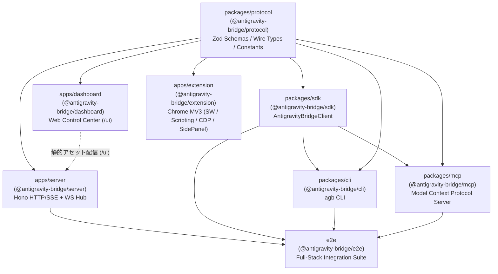
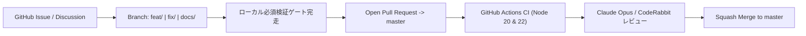

# AGENTS.md — マルチエージェント協調開発ガイド (`antigravity-chrome-bridge`)

本リポジトリは、**Antigravity**・**Claude Code / Claude Opus**・**OpenAI Codex**・**GitHub Copilot SWE Agent**・**Google Jules** などの複数の AI コーディングエージェントと人間の開発者が、コンフリクトを起こさず安全かつ高速に協調開発できるよう設計されたフルスタック・モノレポです。

コードの変更・ブランチの作成・Pull Request の提出を行う前に、必ず本ドキュメントおよび [CLAUDE.md](CLAUDE.md)・[GEMINI.md](GEMINI.md) の規約を確認してください。

---

## 1. モノレポ構成と依存関係グラフ (Dependency DAG)

すべてのワークスペースは `pnpm` ワークスペース + **Turborepo** (`turbo.json`) で管理されており、共通の型・Zod スキーマを単一の真実の源（Single Source of Truth）である `@antigravity-bridge/protocol` に集約しています。



| パス                | パッケージ名                    | 役割                                                                                                               |
| :------------------ | :------------------------------ | :----------------------------------------------------------------------------------------------------------------- |
| `packages/protocol` | `@antigravity-bridge/protocol`  | v1/v2 コマンド定義・Zod スキーマ・バッチ／ワークフロー／トレース型・定数                                           |
| `packages/sdk`      | `@antigravity-bridge/sdk`       | ブリッジサーバーを操作する型安全な TypeScript HTTP クライアント                                                    |
| `apps/dashboard`    | `@antigravity-bridge/dashboard` | `/ui` で配信される Web Control Center フロントエンド (Vite)                                                        |
| `apps/server`       | `@antigravity-bridge/server`    | Hono ベースの HTTP/SSE API (`:8766`) + Chrome 拡張用 WebSocket Hub (`:8767`)                                       |
| `apps/extension`    | `@antigravity-bridge/extension` | Chrome Manifest V3 拡張機能（Service Worker・Scripting/CDP Engine・Side Panel・Recorder）                          |
| `packages/cli`      | `@antigravity-bridge/cli`       | ターミナル操作用 `agb` コマンドラインツール                                                                        |
| `packages/mcp`      | `@antigravity-bridge/mcp`       | AI エージェント接続用の公式 MCP サーバー                                                                           |
| `e2e`               | `@antigravity-bridge/e2e`       | Server + Mock Extension + SDK/CLI/MCP を一気通貫で検証する E2E テストスイート                                      |
| `scripts`           | _(root scripts)_                | 拡張 ZIP 生成 (`package-extension.mjs`)・起動 (`start.sh`/`start.bat`)・Discussions 連携 (`agent-discussions.mjs`) |

---

## 2. ブランチ運用モデル & Pull Request ワークフロー

デフォルトブランチは **`master`**（保護対象）です。`master` への直接 push や force-push は禁止されており、すべての変更はトピックブランチと Pull Request を経由します。



### ブランチ命名規則

作業開始時は最新の `master` から以下のプレフィックスでブランチを作成してください：

- `feat/<slug>` — 新機能・新規コマンド・MCP ツール・UI 拡張（例: `feat/v2.1-hardening-and-agent-ops`）
- `fix/<slug>` — バグ修正・セキュリティ修正・フレーキーテスト解消（例: `fix/cdp-idle-detach`）
- `docs/<slug>` — ドキュメント・ADR・テンプレート更新（例: `docs/multi-agent-governance`）
- `chore/<slug>` — CI/CD・ビルド設定・依存関係更新
- _(補足: GitHub Cloud Agents が自動生成する `copilot/...`・`claude/...`・`codex/...` ブランチも、ターゲットが `master` で関連 Issue/Discussion が明記されていればそのまま受け入れます。)_

---

## 3. モジュール拡張境界 (並列エージェント間のコンフリクト防止ルール)

複数のサブエージェントやクラウドエージェントが同時並行で作業する際、同一ファイルへの衝突を最小化するため以下の境界に従って拡張してください。

| 拡張したい領域                                 | 変更対象ファイルと安全な拡張手順                                                                                                                                                                                                                                                                                                                               |
| :--------------------------------------------- | :------------------------------------------------------------------------------------------------------------------------------------------------------------------------------------------------------------------------------------------------------------------------------------------------------------------------------------------------------------- |
| **新規ブラウザアクション (Command)**           | 1. `packages/protocol/src/commands.ts` に Zod パラメータスキーマと `COMMAND_ACTIONS` を追加（v1 互換フィールドは変更しない）<br>2. `apps/extension/src/engines/scripting/` または `apps/extension/src/engines/cdp/` に実装関数を追加し、ディスパッチャへ登録<br>3. `packages/sdk/src/client.ts` に型付きメソッドを追加し、対応する `__tests__/` にテストを追加 |
| **新規 MCP ツール**                            | `packages/mcp/src/server.ts` の `createMcpBridgeServer()` 内で `server.registerTool(...)` を追加し、内部通信は必ず `@antigravity-bridge/sdk` の `AntigravityBridgeClient` に委譲する。テストは `packages/mcp/src/__tests__/` に追加                                                                                                                            |
| **新規 CLI サブコマンド (`agb`)**              | `packages/cli/src/cli.ts` の `HELP_TEXT` とコマンド分岐に追加し、I/O は必ず注入された `CliIo` (`stdout`/`stderr`/`readFile`/`writeFile`) 経由で行う。テストは `packages/cli/src/__tests__/` に追加                                                                                                                                                             |
| **新規 HTTP/SSE エンドポイント・認可ポリシー** | ルートは `apps/server/src/routes/api.ts`、OpenAPI 定義は `apps/server/src/routes/openapi.ts`、認証・Origin・URL ポリシーは `apps/server/src/middleware/security.ts`、状態管理は `apps/server/src/services/` に分離する                                                                                                                                         |
| **Web Control Center (`/ui`) パネル**          | `apps/dashboard/src/api.ts` に API 呼び出しを追加し、`apps/dashboard/src/main.ts` / `styles.css` で描画する（サーバー側の `apps/server/src/routes/dashboard.ts` は原則変更不要）                                                                                                                                                                               |
| **Chrome Side Panel / Action Recorder**        | `apps/extension/src/sidepanel/` または `apps/extension/src/recorder/` 内で完結させ、Background SW との通信は `chrome.runtime.sendMessage` メッセージ型で疎結合に保つ                                                                                                                                                                                           |

> [!IMPORTANT]
> アーキテクチャおよびセキュリティ上の絶対不変条件（MV3 CSP・`executeScript` 自己完結性・Origin/CSRF・`timingSafeEqual`・スキーム遮断・CDP ライフサイクル）については、[CLAUDE.md](CLAUDE.md) の **6つのコア不変条件** を必ず遵守してください。

---

## 4. 必須検証ゲート (Mandatory Verification Gate)

PR を作成・更新する前、またはタスク完了を報告する前に、リポジトリルートで以下の **5段階の検証ゲート** をすべてエラー・警告ゼロで通過させてください。

```bash
pnpm lint && pnpm build && pnpm typecheck && pnpm test && pnpm package:extension
```

- `pnpm lint`: Biome (`biome.json`) によるコードフォーマット・静的解析チェック（自動修正は `pnpm lint:fix`）
- `pnpm build` (または `pnpm turbo run build`): 依存関係 DAG に従った全ワークスペースのビルド
- `pnpm typecheck` (または `pnpm turbo run typecheck`): 全ワークスペースの TypeScript 型検査 (`tsc --noEmit`)
- `pnpm test` (または `pnpm turbo run test`): 全ユニットテスト + `e2e/` フルスタック統合テストの実行
- `pnpm package:extension`: `apps/extension/dist` から配布用 `release/antigravity-chrome-bridge-extension-v*.zip` の生成検証

---

## 5. GitHub Discussions を用いたマルチモデル知識共有プロトコル

異なるコンテキストウィンドウで動作する複数の AI モデル（**Antigravity**・**Claude Opus**・**OpenAI Codex**・**GitHub Copilot**）間で設計判断（ADR）・セキュリティ監査結果・フェーズ間の引き継ぎ事項を永続化するため、本リポジトリでは **GitHub Discussions** を公式の非同期ナレッジバスとして運用します。

シェルエスケープ事故（Markdown 内のバッククォート `` `code` `` や `$()` の bash 展開）を完全に排除するため、Discussions の読み書きには必ず外部依存ゼロの専用 CLI **`scripts/agent-discussions.mjs`** を使用してください（内部で `gh api graphql --input -` により JSON を標準入力渡しします）。

### 標準メタデータヘッダー規約

エージェントが Discussion トピックの作成または返信を行う際は、`--model` と `--role` を指定してください。CLI が自動的に以下の標準メタデータヘッダーを本文先頭へ付与します：

```markdown
> **Model**: <modelName> | **Role**: <roleName> | **Commit**: <shortSha>
```

### カテゴリの使い分け

| カテゴリ (`slug`)                 | 用途                                                                              |
| :-------------------------------- | :-------------------------------------------------------------------------------- |
| `Ideas` (`ideas`)                 | アーキテクチャ決定記録（ADR）・新機能設計提案・プロトコル拡張案の議論             |
| `General` (`general`)             | マルチエージェント間の作業引き継ぎ（Handoff）・フェーズ進捗報告・ベンチマーク共有 |
| `Q&A` (`q-a`)                     | セキュリティ境界や仕様エッジケースに関する質問・Claude Opus への設計相談          |
| `Announcements` (`announcements`) | メジャーリリース・破壊的変更や運用ポリシー更新の告知                              |

### `scripts/agent-discussions.mjs` 基本コマンド

```bash
# 1. 利用可能な Discussion カテゴリ一覧の確認
node scripts/agent-discussions.mjs categories

# 2. 直近の Discussions 一覧を取得 (タイトル・カテゴリ・コメント数・更新日時)
node scripts/agent-discussions.mjs list --limit 10

# 3. 特定の Discussion (#N) の本文と全コメント・スレッド返信を Markdown で閲覧
node scripts/agent-discussions.mjs view <NUMBER>

# 4. 新規 ADR / 引き継ぎトピックの作成 (--body-file 推奨)
node scripts/agent-discussions.mjs create \
  --category Ideas \
  --title "ADR-001: Localhost CSRF Origin Validation & CDP Auto-Detach" \
  --model "Antigravity" \
  --role "Lead Implementer" \
  --body-file /tmp/discussion_body.md

# 5. 既存の Discussion (#N) へのレビュー結果・引き継ぎコメント投稿
node scripts/agent-discussions.mjs reply <NUMBER> \
  --model "Claude Opus" \
  --role "Architecture & Security Reviewer" \
  --body-file /tmp/reply_body.md
```
