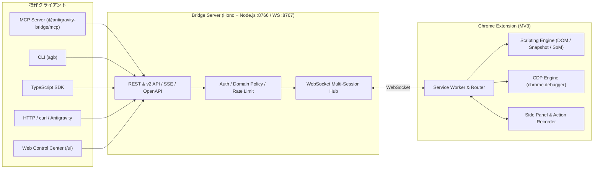

# Antigravity Chrome Bridge 

[](LICENSE)
[](https://www.google.com/chrome/)
[](https://nodejs.org/)
[](https://www.typescriptlang.org/)
[](https://modelcontextprotocol.io/)

Antigravity / AIエージェント / スクリプトから **実在の Chrome ブラウザ** を自在に操作するための、フルスタック・ブラウザオートメーション基盤です。本家使えないとき用。

---

##  ハイライト

- **🎯 AI Snapshot (`@eN`) & Set-of-Mark**: ページ内の操作可能要素を抽出し、`@e1`・`@e2` などの安定した参照IDを付与。`--overlay` で画面上に視覚バッジを描画したスクリーンショットも取得でき、AIエージェントが迷わずクリック・入力できます。
- **⚡ Dual Engine (`Scripting + CDP`)**: 通常の高速な `chrome.scripting` エンジンに加え、`chrome.debugger` (CDP) エンジンを自動/明示的に切り替え可能。信頼済みキーボード入力 (`press_key`)、ドラッグ＆ドロップ、ファイルアップロード、フルページスクリーンショット、コンソール/ネットワークログ監視に対応。
- **🔌 MCP / CLI (`agb`) / TypeScript SDK / HTTP API**: AIクライアント向けの公式 MCP サーバー (`@antigravity-bridge/mcp`)、軽快な CLI (`agb`)、型安全な SDK (`@antigravity-bridge/sdk`)、v1完全互換の HTTP API の4系統を提供。
- **🎬 Chrome Side Panel & Action Recorder**: 拡張機能の Side Panel に **Antigravity Studio** を内蔵。Live Command Feed のリアルタイム監視に加え、ブラウザ操作を録画して **Batch JSON / `agb` CLI / TypeScript SDK** コードへ即座にエクスポートできます。
- **🖥️ Web Control Center (`/ui`) & OpenAPI (`/docs`)**: サーバー起動と同時に `http://localhost:8766/ui` でリアルタイムダッシュボードが利用可能。SSE による実行トレース配信や保存済みワークフローのワンクリック実行に対応。
- **🛡️ Multi-Profile & Security**: 複数ブラウザプロファイルの `sessionId` ルーティング、Bearer トークン認証、ドメイン許可/ブロックポリシー、`file://` アクセス制御、スライディングウィンドウ・レート制限を標準装備。

---

## 🏗️ システム構成 & モノレポ構成

### アーキテクチャ



### モノレポ構成

```text
antigravity-chrome-bridge/
├── apps/
│   ├── extension/       # Chrome MV3 拡張機能 (Background, Scripting/CDP Engines, Popup, Side Panel, Action Recorder)
│   ├── server/          # Hono HTTP/SSE + WebSocket ブリッジサーバー (Security, Traces, Workflows, OpenAPI)
│   └── dashboard/       # Web Control Center (/ui として server にバンドル配信)
├── packages/
│   ├── protocol/        # Zod スキーマ・型定義・定数 (全32コマンド / Batch / Workflow / Session / Trace)
│   ├── sdk/             # @antigravity-bridge/sdk (AntigravityBridgeClient)
│   ├── cli/             # @antigravity-bridge/cli (agb コマンド)
│   └── mcp/             # @antigravity-bridge/mcp (公式 Model Context Protocol サーバー)
├── e2e/                 # フルスタック E2E テストスイート (Server + Mock Extension + SDK/CLI/MCP)
├── scripts/             # ビルド・パッケージング用スクリプト (package-extension.mjs)
└── .github/workflows/   # GitHub Actions CI/CD ワークフロー
```

---

## 🚀 クイックスタート

### 1. インストール・ビルド・サーバー起動

```bash
pnpm install
pnpm build
pnpm start
```

起動すると以下のエンドポイントが利用可能になります：
- **HTTP API**: `http://127.0.0.1:8766`
- **WebSocket (Chrome拡張接続用)**: `ws://127.0.0.1:8767`
- **Web Control Center**: `http://127.0.0.1:8766/ui`
- **OpenAPI / Swagger UI**: `http://127.0.0.1:8766/docs`

### 2. Chrome 拡張機能の読み込み

1. Chrome で `chrome://extensions/` を開く
2. 右上の **「デベロッパーモード」** を ON にする
3. **「パッケージ化されていない拡張機能を読み込む」** をクリック
4. ビルド済みの `apps/extension/dist` フォルダを選択
5. 拡張機能アイコンをクリックし、ステータスが **接続済み** になることを確認

> 💡 配布用 ZIP を作成したい場合は `pnpm package:extension` を実行すると `release/antigravity-chrome-bridge-extension-v2.0.0.zip` が生成されます。

### 3. Web Control Center & OpenAPI Docs

- **Web Control Center (`http://localhost:8766/ui`)**: 接続中のブラウザプロファイル一覧、AI Snapshot (`@eN`) のインタラクティブ操作、スクリーンショットプレビュー、保存済みワークフロー管理、SSE によるリアルタイム実行トレースをブラウザ上で確認できます。
- **OpenAPI Docs (`http://localhost:8766/docs`)**: 全 API エンドポイントのインタラクティブな仕様書（`/openapi.json`）を閲覧できます。

---

## 🎮 4つの操作インターフェース

### 1. 専用 CLI (`agb`)

ビルド後、リポジトリルートから `pnpm agb ...` で実行できます（グローバルリンク後は `agb ...`）。

```bash
# 接続状態とセッション一覧の確認
pnpm agb status
pnpm agb sessions

# URL へ移動
pnpm agb nav https://example.com

# AI Snapshot を取得（--overlay で視覚バッジ描画 / --compact で省トークン形式）
pnpm agb snap --overlay
pnpm agb snap --compact

# @eN 参照ID または CSS セレクタで操作・出現待機
pnpm agb click @e1
pnpm agb type @e2 "Antigravity"
pnpm agb key Enter
pnpm agb wait "#loaded" --timeout 5000
pnpm agb url

# スクリーンショット保存（--full でフルページ）
pnpm agb shot page.png --full

# コンソール・ネットワークログ取得 / バッチ実行
pnpm agb logs --errors
pnpm agb logs --network
pnpm agb batch workflow.json
```

<details>
<summary>CLI グローバルオプション & 全サブコマンド</summary>

- グローバルオプション: `-u, --url <httpUrl>`, `-s, --session <id>`, `-t, --token <token>`, `-j, --json`, `--compact`, `-h, --help`
- サブコマンド: `status`, `sessions`, `traces`, `nav`, `snap`, `click`, `type`, `key`, `wait`, `shot`, `eval`, `text`, `url`, `tabs`, `logs`, `batch`
- 環境変数: `AGB_URL`, `AGB_SESSION`, `AGB_TOKEN` にも対応しています。

</details>

### 2. 公式 MCP サーバー (`@antigravity-bridge/mcp`)

Claude Desktop / Claude Code / Cursor / Antigravity などの MCP 対応クライアントに設定を追加します（先にブリッジサーバーと Chrome 拡張を起動しておいてください）。

```json
{
  "mcpServers": {
    "antigravity-chrome-bridge": {
      "command": "node",
      "args": ["/absolute/path/to/antigravity-chrome-bridge/packages/mcp/dist/bin.js"],
      "env": {
        "AGB_URL": "http://127.0.0.1:8766",
        "AGB_TOKEN": ""
      }
    }
  }
}
```

#### 提供 MCP ツール一覧 (全25ツール)

| ツール名 | 説明 |
|:---|:---|
| `browser_status` | ブリッジ接続状態・セッション一覧・直近トレース取得 |
| `browser_navigate` | 指定 URL へ遷移 |
| `browser_snapshot` | AI DOM Snapshot (`@eN`, Shadow DOM対応, `format: "compact"` で省トークン出力, `markOverlay: true` で画像返却) |
| `browser_click` | `@eN` 参照または CSS セレクタをクリック (`auto` 自動CDPフォールバック対応) |
| `browser_type` | `@eN` 参照または CSS セレクタへテキスト入力 (`auto` 自動CDPフォールバック対応) |
| `browser_press_key` | CDP 経由の信頼済みキー入力（修飾キー対応） |
| `browser_hover` | `@eN` 参照または CSS セレクタにホバー |
| `browser_select` | `<select>` ドロップダウンの値を選択 |
| `browser_scroll` | 方向・座標・要素指定でスクロール |
| `browser_wait_for` | 指定セレクタの DOM 出現を待機 |
| `browser_get_text` | ページ全体または指定セレクタの可視テキストを取得 |
| `browser_upload_file` | CDP 経由でファイル入力要素へローカルファイルを設定 |
| `browser_drag_and_drop` | CDP 経由で要素/座標間のドラッグ＆ドロップを実行 |
| `browser_screenshot` | Viewport / フルページ / 要素クロップのスクリーンショット取得 |
| `browser_evaluate` | タブ内で CDP `Runtime.evaluate` 経由の非同期 JavaScript を実行 |
| `browser_tabs` | 開いているタブとタブグループ一覧を取得 |
| `browser_new_tab` | 新しいタブを開く |
| `browser_close_tab` | 指定またはアクティブなタブを閉じる |
| `browser_switch_tab` | 指定 `tabId` のタブへ切り替え |
| `browser_reload` | タブをリロード |
| `browser_go_back` | ブラウザ履歴を戻る |
| `browser_console_logs` | CDP で収集したコンソールログを取得 |
| `browser_network_logs` | CDP で収集したネットワーク通信ログを取得 |
| `browser_batch` | 複数コマンドを順次実行 (`POST /api/v2/batch`) |
| `browser_workflows` | 保存済みワークフローの一覧取得・ID指定実行 |

### 3. TypeScript SDK (`@antigravity-bridge/sdk`)

```ts
import { AntigravityBridgeClient } from '@antigravity-bridge/sdk';

const client = new AntigravityBridgeClient({
  baseUrl: 'http://127.0.0.1:8766',
  // authToken: process.env.AGB_AUTH_TOKEN,
  // sessionId: 'default-xxxx',
});

await client.navigate('https://example.com');

const snap = await client.snapshot({ interactiveOnly: true, markOverlay: true });
console.log(snap.elements); // [{ ref: '@e1', role: 'link', text: 'More information...', ... }]

await client.click('@e1', { engine: 'cdp' });
const shot = await client.screenshot({ fullPage: true });
```

### 4. HTTP API (v1 完全互換 & v2 拡張)

| メソッド | パス | 説明 |
|:---|:---|:---|
| `POST` | `/command` | 単一コマンドを実行（v1 完全互換。`sessionId` 指定可） |
| `POST` | `/api/v2/batch` | 複数ステップのバッチ実行 (`steps`, `stopOnError`, `sessionId`) |
| `GET` | `/api/v2/sessions` | 接続中の拡張機能セッション一覧 |
| `GET` | `/api/v2/traces` | コマンド実行トレース履歴 (`?limit=50`) |
| `GET` | `/api/v2/workflows` | 保存済みワークフロー一覧 |
| `POST` | `/api/v2/workflows` | ワークフローの作成・更新 |
| `DELETE` | `/api/v2/workflows/:id` | ワークフローの削除 |
| `POST` | `/api/v2/workflows/:id/run` | 保存済みワークフローの実行 |
| `GET` | `/api/v2/events` | リアルタイム SSE イベントストリーム (`snapshot`, `trace`, `session`, `command`) |
| `GET` | `/status` | サーバー・拡張機能の接続状態 |
| `GET` | `/health` | ヘルスチェック |
| `GET` | `/ui` | Web Control Center |
| `GET` | `/docs` / `/openapi.json` | OpenAPI 仕様書・ドキュメント UI |

```bash
# v1 互換の単一コマンド
curl -X POST http://127.0.0.1:8766/command \
  -H "Content-Type: application/json" \
  -d '{"action":"navigate","params":{"url":"https://example.com"}}'

# v2 バッチ実行
curl -X POST http://127.0.0.1:8766/api/v2/batch \
  -H "Content-Type: application/json" \
  -d '{"steps":[{"action":"navigate","params":{"url":"https://example.com"}},{"action":"snapshot","params":{"markOverlay":true}}]}'
```

---

## 🎬 Chrome Side Panel & Action Recorder

Chrome ツールバーの拡張機能アイコンのコンテキストメニューまたはポップアップの **「Side Panel」** から **Antigravity Studio** を開けます。

1. **Live Feed タブ**:
   - `Run AI Snapshot (Overlay)` / `Clear Marks` のワンクリック実行
   - バックグラウンドで実行された全コマンドの成功/失敗・所要時間をリアルタイム表示
2. **Action Recorder タブ**:
   - **Record** を押して Chrome 上でクリック・入力・遷移・選択を行うとステップを自動記録
   - 記録した操作を **Batch JSON** / **`agb` CLI スクリプト** / **TypeScript SDK コード** として即座にコピー可能
3. **Quick Runner タブ**:
   - `navigate` / `snapshot` / `evaluate` をブラウザ横から即テスト実行

> 操作対象タブは自動的に「🤖 Antigravity」タブグループで整理されます。

---

## 📖 全コマンドリファレンス (全32アクション)

### ナビゲーション & タブ管理

| コマンド | 説明 | 主なパラメータ |
|:---|:---|:---|
| `navigate` | URL へ移動 | `url` (必須), `tabId` |
| `new_tab` | 新しいタブを開く | `url` |
| `close_tab` | タブを閉じる | `tabId` |
| `switch_tab` | タブを切り替え | `tabId` (必須) |
| `go_back` | 履歴を戻る | `tabId` |
| `go_forward` | 履歴を進む | `tabId` |
| `reload` | ページをリロード | `tabId` |
| `get_url` | 現在の URL を取得 | `tabId` |
| `get_tabs` | タブ一覧とグループ状態を取得 | — |

### AI Snapshot & 視覚マーカー (v2)

| コマンド | 説明 | 主なパラメータ |
|:---|:---|:---|
| `snapshot` | `@eN` 参照付き DOM スナップショット取得 | `interactiveOnly` (既定 `true`), `markOverlay`, `maxElements`, `tabId` |
| `clear_marks` | ページ上の `@eN` オーバーレイバッジを削除 | `tabId` |

### DOM 操作 & 高度な CDP 操作

| コマンド | 説明 | 主なパラメータ |
|:---|:---|:---|
| `click` | 要素をクリック | `selector` または `ref` (`@e1`), `engine` (`auto`/`scripting`/`cdp`), `allFrames`, `tabId` |
| `click_at` | 座標を指定してクリック | `x` (必須), `y` (必須), `allFrames`, `tabId` |
| `type` | テキスト入力 | `selector` または `ref`, `text` (必須), `clear`, `engine`, `allFrames`, `tabId` |
| `hover` | 要素にホバー | `selector` または `ref`, `engine`, `allFrames`, `tabId` |
| `select` | ドロップダウン選択 | `selector` または `ref`, `value` (必須), `engine`, `tabId` |
| `scroll` | スクロール | `direction` + `amount` / `x` + `y` / `selector` / `ref`, `engine`, `allFrames`, `tabId` |
| `press_key` | **v2** 信頼済みキーボード入力 (CDP) | `key` (必須), `modifiers` (`Alt`/`Control`/`Meta`/`Shift`), `selector`/`ref`, `text`, `tabId` |
| `drag_and_drop` | **v2** ドラッグ＆ドロップ (CDP) | `sourceSelector`/`sourceRef`/`sourceX,Y` & `targetSelector`/`targetRef`/`targetX,Y`, `tabId` |
| `upload_file` | **v2** ファイル入力へファイル設定 (CDP) | `selector` または `ref`, `files` (パス配列, 必須), `tabId` |

### コンテンツ・ログ・スクリーンショット

| コマンド | 説明 | 主なパラメータ |
|:---|:---|:---|
| `get_content` | HTML を取得 | `selector`, `allFrames`, `tabId` |
| `get_text` | テキストを取得 | `selector`, `allFrames`, `tabId` |
| `get_elements` | 要素情報を取得 | `selector` (必須), `limit`, `allFrames`, `tabId` |
| `screenshot` | スクリーンショット取得（**v2** フルページ・要素クロップ・SoM対応） | `format` (`png`/`jpeg`), `quality`, `fullPage`, `selector`/`ref`, `markOverlay`, `tabId` |
| `get_console_logs` | **v2** コンソールログ取得 (CDP) | `level` (`all`/`error`/`warn`/`info`/`log`), `limit`, `clear`, `tabId` |
| `get_network_logs` | **v2** ネットワーク通信ログ取得 (CDP) | `urlPattern`, `errorsOnly`, `limit`, `clear`, `tabId` |

### iframe 操作 & スクリプト・待機

| コマンド | 説明 | 主なパラメータ |
|:---|:---|:---|
| `iframe_click` | iframe 内の要素をクリック | `selector` (必須), `frameUrl`, `tabId` |
| `iframe_click_at` | iframe 内の座標をクリック | `x` (必須), `y` (必須), `frameUrl`, `tabId` |
| `iframe_get_elements` | iframe 内の要素情報を取得 | `selector` (必須), `limit`, `frameUrl`, `tabId` |
| `iframe_get_text` | iframe 内のテキストを取得 | `selector`, `frameUrl`, `tabId` |
| `evaluate` | JavaScript を実行 | `code` (必須), `tabId` |
| `wait_for` | 要素の出現を待機 | `selector` (必須), `timeout` (既定 `10000`ms), `tabId` |

---

## ⚙️ 環境変数・セキュリティ設定

ブリッジサーバーは以下の環境変数で挙動とセキュリティポリシーを制御できます：

| 環境変数 | デフォルト値 | 説明 |
|:---|:---|:---|
| `HOST` | `127.0.0.1` | バインドするホストアドレス |
| `HTTP_PORT` | `8766` | HTTP API / Web UI ポート |
| `WS_PORT` | `8767` | WebSocket ポート (Chrome 拡張用) |
| `COMMAND_TIMEOUT_MS` | `30000` | コマンドのタイムアウト (ms) |
| `AGB_AUTH_TOKEN` | 未設定 | 設定すると `/command`・`/status`・`/api/v2/*` に `Authorization: Bearer <token>` が必須になります |
| `AGB_WS_REQUIRE_TOKEN` | `false` | `true` の場合、WebSocket 接続時にも `?token=` または `Authorization` でトークン検証を実施 |
| `AGB_ALLOWED_DOMAINS` | 未設定 | カンマ区切りの許可ドメイン（例: `example.com,*.internal.local`）。設定時は一致ドメインのみ遷移許可 |
| `AGB_BLOCKED_DOMAINS` | 未設定 | カンマ区切りの拒否ドメイン（許可リストより優先してブロック） |
| `AGB_ALLOW_FILE_URLS` | `false` | `true` の場合のみ `file://` URL への遷移を許可（`data:` / `blob:` / `chrome:` 等は常時ブロック） |
| `AGB_ALLOWED_ORIGINS` | 未設定 | 追加許可するブラウザ `Origin`（既定で `chrome-extension://*` とローカルループバックのみ許可し外部サイトの CSRF を遮断） |
| `AGB_TRUST_PROXY` | `false` | `true` の場合のみレート制限で `X-Forwarded-For` / `X-Real-IP` を信頼 |
| `AGB_RATE_LIMIT_PER_MIN` | `600` | IP あたり 1 分間の HTTP API リクエスト上限 |
| `AGB_WORKFLOWS_FILE` | 未設定 | 保存済みワークフローの JSON 永続化ファイルパス（未設定時はインメモリ） |

```bash
AGB_AUTH_TOKEN="my-secret" \
AGB_ALLOWED_DOMAINS="example.com,*.github.com" \
AGB_RATE_LIMIT_PER_MIN=300 \
pnpm start
```

---

## 🤝 マルチエージェント協調 & GitHub Discussions 連携

本リポジトリは Antigravity・Claude Opus / Claude Code・Codex・Copilot などの複数モデル間で設計議論（ADR）・コンテキスト引き継ぎを行えるよう整備されています。

- 開発規約・拡張境界: [AGENTS.md](AGENTS.md)
- Claude Opus アーキテクチャ/セキュリティ監査ガイド: [CLAUDE.md](CLAUDE.md)
- Antigravity / クラウドエージェント運用ポリシー: [GEMINI.md](GEMINI.md)
- Discussions 読み書き補助 CLI（シェルエスケープ不要）:
  ```bash
  node scripts/agent-discussions.mjs list
  node scripts/agent-discussions.mjs view 1
  ```

---

## 🧪 開発・テストコマンド

```bash
# 全ワークスペースのビルド
pnpm build

# リンター・フォーマットチェック (Biome)
pnpm lint
pnpm lint:fix

# TypeScript 型チェック
pnpm typecheck

# 全ユニットテスト + フルスタック E2E テストの実行
pnpm test

# Chrome 拡張機能の ZIP パッケージング (release/ に出力)
pnpm package:extension
```

---

## ⚠️ 注意事項

- Chrome 116 以降が必要です（Manifest V3 Service Worker WebSocket keepalive 対応）
- `chrome://` や Chrome ウェブストア等の内部ページでは拡張機能による操作が制限されます
- スクリーンショットの `chrome.tabs.captureVisibleTab` は表示中タブを対象とします（`fullPage: true` は CDP 経由で全体撮影）
- ドパガキ駆動開発なのであんまり信用しないでください

## 📄 ライセンス

このプロジェクトは [MIT License](LICENSE) の下で公開されています。
